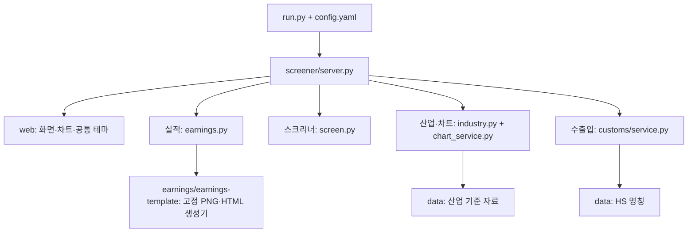

# 프로그램 구조

`run.py`가 `config.yaml`을 읽고 `screener.server.serve()`로 로컬 HTTP 서버를 시작한다.
화면 자산은 `web/`, 공유 기준 자료는 `data/`, 사용자가 만드는 데이터는 별도 로컬 파일에 저장한다.

## 기능별 모듈

| 기능 | 모듈 | 로컬 저장 |
|---|---|---|
| 실적 입력·작업 상태 | `earnings.py`, `earnings_financials.py` | `earnings_workspace/` |
| 실적 원문·완성본 | `earnings.py`, `earnings_market.py`, `earnings/earnings-template/` | `earnings/자료/`, `earnings/결과/` |
| 신고가·정배열 | `universe.py` → `data.py` → `indicators.py` → `screen.py` → `report.py` | `cache/`, `screen_cache*.json` |
| 시장 Recap | `recap.py`, `naver.py`, `recap_report.py`, `weekly.py` | `recap_cache.json` |
| 산업 분류 | `industry.py` | 개인 수정 `industry_overrides.json`; 가져오기 이력 `classification_reports/` |
| 종목·ETF·차트 | `instruments.py`, `chart_service.py`, `chart_data.py`, `sector_etfs.py` | `instruments.sqlite3`, `chart_cache/`, `sector_etfs.json` |
| 기존 섹터 분류 | `sectors.py`, `sector_classification.py` | `sectors.json`, `classification_sources/`, `classification_reports/` |
| 증권 유형 제외 | `security_policy.py` | `instrument_exclusions.json` |
| 수출입 | `customs/service.py`, `db.py`, `collector.py`, `report.py`, `names.py` | `customs_workspace/` |
| 정적 내보내기 | `report.py`, `customs/report.py` | `output/` |

`ui.py`가 `web/ui.css`와 `web/ui.js`를 정적 리포트에도 삽입한다.
브라우저 경로는 파일 이동 전과 같으며 `/chart-assets/*`는 `web/chart-assets/`에서 제공한다.
실적 생성기는 Node.js 기본 모듈과 Pillow를 사용한다. 별도 npm 설치가 필요하지 않다.

## 기준 자료와 사용자 수정

공유 가능한 산업 마스터·기업 배정·산업 확장·HS 명칭은 `data/`에 포함한다.
기업 배정에는 자동 분류 초안과 검토 상태가 들어 있으며, 이 상태를 화면에서 구별한다.
사용자가 화면에서 바꾸는 산업 분류는 `industry_overrides.json`에 따로 저장한다.
참고 엑셀 `KUIM_전체결과표.xlsx`가 로컬에 있으면 기존처럼 변경을 확인해 `data/`에 다시 가져온다.
엑셀이 없어도 포함된 JSON으로 서버를 시작할 수 있다.

## Git에 포함하지 않는 파일

- 자격 증명: `.env`, `.env.*` (`.env.example`만 포함)
- 개인 입력·완성본: 실적 원문·결과, 각 workspace, 개인 분류·ETF 설정
- 생성·수집 결과: 가격 캐시, DB, 수집 원문, 분류 검토 원장, 정적 HTML
- 작업 기록: `.ui-work/`, `.local/`, 로그·임시 파일·Python 캐시·환경 폴더
- 가져오기용 사용자 엑셀: `KUIM_*.xlsx`

`.local/maintenance/`에는 이전 폴더 정리의 파일 목록·해시와 일회성 스크립트를 로컬 기록으로 보관한다.
실행 코드가 이 기록을 읽거나 외부 형제 폴더에 의존하지 않는다.

## 검증 방식

`python scripts/check.py`는 문법과 `tests/`의 회귀 검증을 실행한다.
실적 검증은 명시적인 가상 수치 fixture, 산업 검증은 공유 자료와 임시 DB를 사용한다.
사용자의 보고서·시세 DB·캐시·산업 수정 파일을 테스트 입력으로 사용하거나 수정하지 않는다.
`python scripts/check_repository.py`는 현재 존재하는 Git 업로드 후보를 검사한다.
